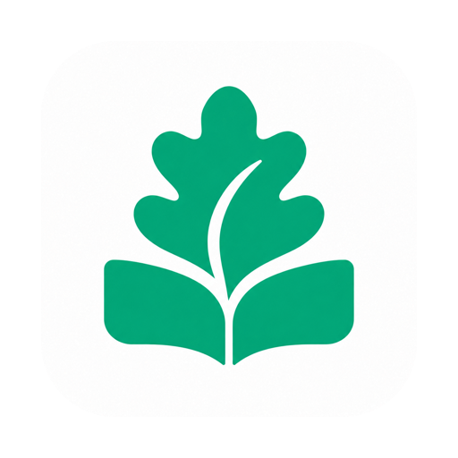

  

<h1 align="center">Folioak</h1>

<a href="README.md">English</a> · <strong>简体中文</strong>

**原生 macOS 下载器，保存论文与媒体。**

- **文档**：arXiv、Hugging Face 论文页、OpenReview、ACL、CVF、GitHub PDF 和公开 PDF 直链。
- **媒体**：YouTube、Bilibili、X、今日头条、小红书、抖音、TikTok、Instagram、Vimeo 的单个视频，以及图片／音视频直链。
- **归档**：一个保存位置，自动分入 `Papers`、`Videos`、`Audio`、`Images`，可在文档库和媒体库中查找。

内置完整下载组件，无需安装 Python 或 Homebrew。站点下载取决于当前网络能否公开访问；部分站点对公开视频也要求登录或验证，应用不会导入浏览器凭据。不支持播放列表、账号主页和纯图文帖子。小红书请粘贴完整视频分享链接并保留访问参数，也识别 `xhslink.com` 短链。今日头条请使用 `/video/数字/` 详情页链接。

## 安装

[下载最新版](https://github.com/cleardusk/folioak/releases/latest) · Apple Silicon · macOS 13+

打开 DMG，将 Folioak 拖入 Applications。当前未做 Apple 公证，首次打开可能需要在系统「隐私与安全性」中允许打开。

## 使用

粘贴或拖入链接，点击下载按钮或按 `⌘ Return`；再次点击可停止。支持多条链接、失败重试和下载后快速预览。

在「设置 → 通用 → 语言」选择跟随系统、简体中文或 English，切换立即生效。

全新安装默认保存到 `~/Downloads/Folioak`；分类子文件夹按需创建。点击目录即可更改保存位置。升级保留已有设置、文件和资料库；从旧品牌升级时，退出旧应用，安装 Folioak 后将旧应用移出 Applications。

[命令行用法](CLI-README.md)

## 开发

运行 `./build.command` 构建，`./test.command` 测试；需要 Xcode 或 Command Line Tools 和 Python 3.9+。

[开发指南（English）](CONTRIBUTING.md) · [构建与发布](RELEASING.md) · [设计](DESIGN.md) · [安全与实测](SECURITY-AUDIT.md) · [媒体组件](Resources/MediaComponents.md)

项目源码采用 [MIT 许可证](LICENSE)；内置第三方组件遵循各自许可证。
